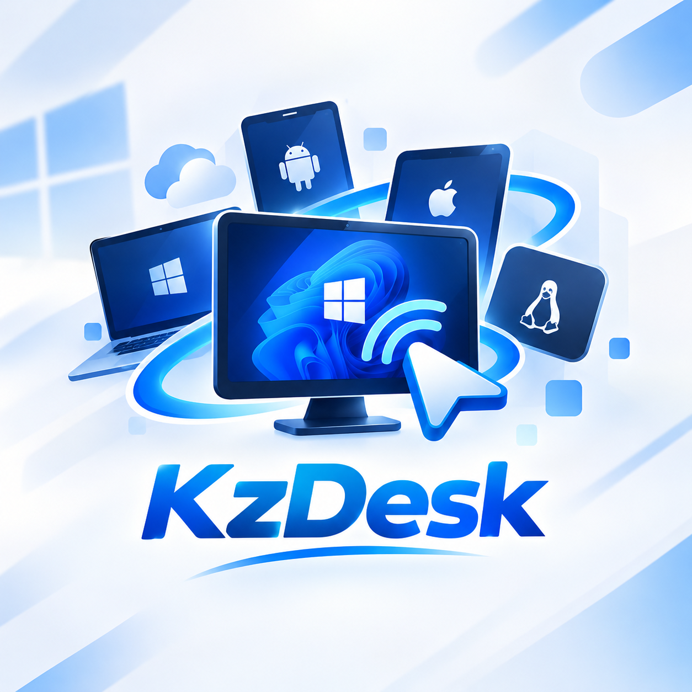

<p align="center"></p>

<h1 align="center">KzDesk Remote</h1>

<p align="center">Kendalikan PC Windows dari Android, iOS, dan desktop — lewat RDP.<br>
Dikembangkan oleh <b>KazamaDev</b> · Package Android <code>com.kazamatech.kzdesk</code></p>

---

## Tentang

KzDesk Remote adalah aplikasi remote desktop untuk mengendalikan PC dari jarak jauh. Ia memakai
protokol RDP (berbasis FreeRDP) dengan antarmuka dan alat bantu yang dirancang untuk layar sentuh:
kontrol layar yang bisa disusun, joystick, keyboard dan mouse fisik, serta pemasangan host sekali
jalan yang memperbarui dirinya sendiri.

## Fitur

- **Dua cara terhubung** — RDP via IP + username + password, atau **ID Device + password** tanpa perlu menghafal IP.
- **Mikrofon HP → PC** — suara dari HP menjadi input suara di PC; suara PC diputar di HP.
- **Template Controller (JSON)** — susun tombol dan joystick, simpan sebagai template, impor/ekspor.
- **Joystick per kontrol** — mode WASD, Panah, atau Kursor/Kamera dengan sensitivitas dan deadzone.
- **Keyboard & mouse fisik** — dipakai langsung; kontrol layar menyingkir otomatis.
- **Stylus / S-Pen** — kursor mengikuti ujung pena, tombol pena menjadi klik kanan.
- **Picture-in-Picture**, **widget layar utama**, dan **notifikasi koneksi putus**.
- **Scan QR** dari host untuk mengisi ID dan password.
- **Auto-update** — aplikasi dan host mendeteksi rilis baru, mengunduh, dan memverifikasi SHA-256.
- **Push notification** (opsional) — rilis baru, pengumuman, dan status PC online/offline.
- **Laporan crash** (opsional, opt-in) — hanya stack trace yang disamarkan.
- Antarmuka bergaya SaaS hitam–ungu, dua bahasa (Indonesia/Inggris), tanpa iklan dan tanpa pelacak.

## Platform

| Platform | Peran | Berkas rilis |
|---|---|---|
| Android 7.0+ | Aplikasi utama (klien) | `KzDesk-Remote-<abi>.apk` |
| iOS 15+ | Klien RDP | `KzDesk-Remote-ios.ipa` (tanpa tanda tangan) |
| Windows 10/11 Pro+, Server | **Host** (yang dikendalikan) | `KzDesk-Host-Setup.exe` |
| Windows, macOS, Linux | Klien desktop RDP | `KzDesk-Desktop-<os>-<arsitektur>` |

> Host hanya tersedia untuk Windows (edisi yang mendukung Remote Desktop). Windows Home tidak didukung sebagai host.

## Alur kerja

### Koneksi RDP via IP
```
HP ──(IP, username, password Windows)──► RDP langsung ──► PC
```

### Koneksi ID Device + password
```
KzDesk Host (PC) ──heartbeat: ID, alamat LAN/VPN, verifier password──► Server KzDesk (direktori)
HP ──ID + password──► Server ──(alamat bila password benar)──► HP
HP ──mencoba LAN → VPN → IP publik──► RDP ke akun "KzDesk" di PC
```
- Password tidak pernah disimpan di server; host mengirim verifier PBKDF2 saja.
- Server hanya **direktori**, bukan relay: lalu lintas RDP langsung antara HP dan PC. Dari internet, PC
  membutuhkan port RDP yang dapat dijangkau atau jaringan VPN.
- ID salah dan password salah memberi respons yang sama; ada pembatasan percobaan per IP dan per ID.

### Pembaruan otomatis
```
Rilis baru di GitHub ─► Server membaca rilis (URL + SHA-256)
   ├─ Aplikasi Android: cek berkala → unduh di Wi-Fi → verifikasi → satu ketukan pasang
   └─ KzDesk Host:      cek tiap 6 jam → unduh → verifikasi → pasang senyap
```
Pembaruan hanya ditawarkan bila berkas memiliki checksum dan berasal dari GitHub atau server KzDesk.

### Rilis
Satu workflow membangun semua platform dan memublikasikannya ke satu GitHub Release `v<versi>`
(Android, iOS, installer Host Windows, klien desktop Windows/macOS/Linux) beserta `SHA256SUMS.txt`.
Platform yang gagal dibangun pada suatu run dilewati dan dicatat di catatan rilis.

## Struktur repositori

| Folder | Isi |
|---|---|
| `client/Android/Studio/app` | Aplikasi Android KzDesk (Kotlin, Jetpack Compose) |
| `client/iOS` | Klien iOS (Objective-C, turunan klien iOS FreeRDP) |
| `host-agent/windows` | KzDesk Host: installer, layanan latar, updater, halaman pairing QR |
| `kzdesk-web` | Situs dan API (Node.js, Express, EJS): update, direktori ID, push, crash |
| `scripts/desktop` | `kzdesk-connect` untuk klien desktop (ID Device + password) |
| `templates` | Contoh Template Controller (JSON) |
| `docs` | Dokumentasi teknis, format template, roadmap |
| `.github/workflows` | Pipeline build dan rilis |

## Privasi dan keamanan

- Tidak ada iklan dan tidak ada SDK pelacak. Push dan laporan crash bersifat **opt-in**.
- Server menyimpan: ID perangkat, nama host, alamat IP yang dilaporkan host, verifier password, dan waktu terakhir aktif
  (hanya untuk mode ID Device). Data tidak aktif 30 hari dihapus otomatis.
- Koneksi RDP memakai NLA. Akun Windows khusus `KzDesk` dibuat dengan hak pengguna biasa dan disembunyikan dari layar login.
- Kebijakan lengkap: situs → Kebijakan Privasi. Pelaporan celah keamanan: lihat `SECURITY.md`.

## Keterbatasan saat ini

- Belum ada **PC Stream** (streaming layar berbasis WebRTC) dan **Virtual Display Adapter** — lihat `docs/ROADMAP.md`.
- Build iOS dirilis **tanpa tanda tangan**; push iOS memerlukan akun Apple Developer berbayar.
- Klien desktop adalah klien RDP SDL; fitur HUD/template ada di aplikasi mobile.
- Direktori ID Device bukan relay/NAT traversal.

## Hak cipta dan lisensi

© 2026 **KazamaDev**. Seluruh hak dilindungi untuk kode dan materi KzDesk
(lihat `NOTICE.md`).

Proyek ini memuat dan dibangun di atas **FreeRDP** (Apache License 2.0, © para kontributor FreeRDP) beserta
komponen pihak ketiga lain dengan lisensinya masing-masing. Daftar lengkap komponen, lisensi, dan perubahan
terhadap berkas FreeRDP ada di [`NOTICE.md`](NOTICE.md); teks Apache-2.0 ada di [`LICENSE`](LICENSE).
"KzDesk" adalah merek KazamaDev. "FreeRDP" adalah merek proyek FreeRDP; KzDesk bukan produk resmi FreeRDP.

## Donasi

KzDesk Remote gratis. Dukung pengembangannya: **<https://www.kazamasite.biz.id/donate>**

## Kontak

Situs: <https://kzdesk.kazamasite.biz.id> · Pengembang: KazamaDev · <https://www.kazamasite.biz.id>
